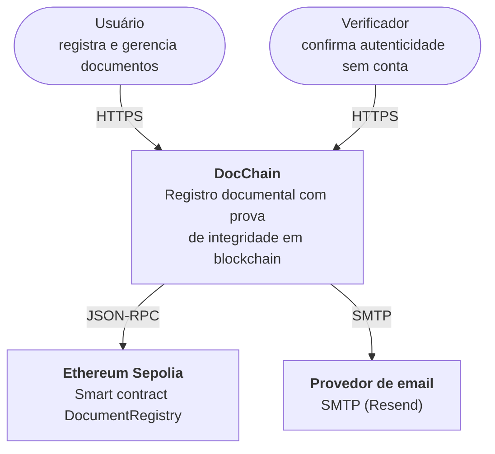
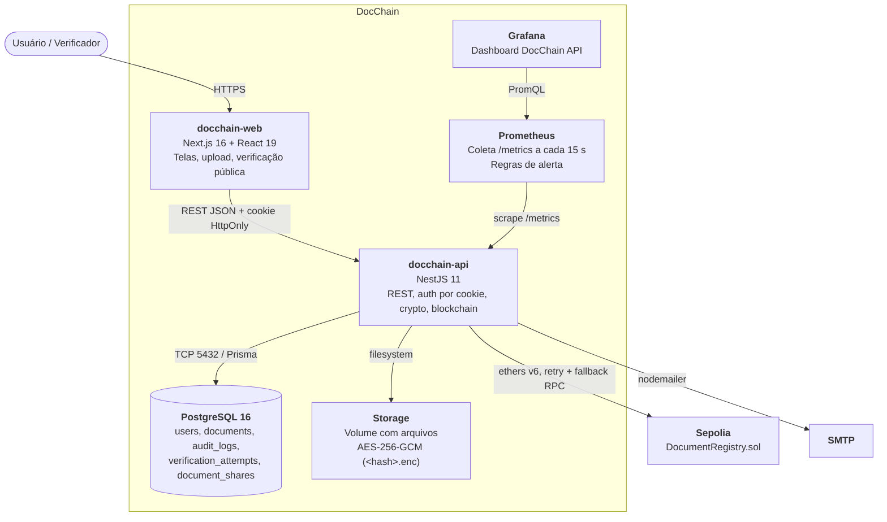
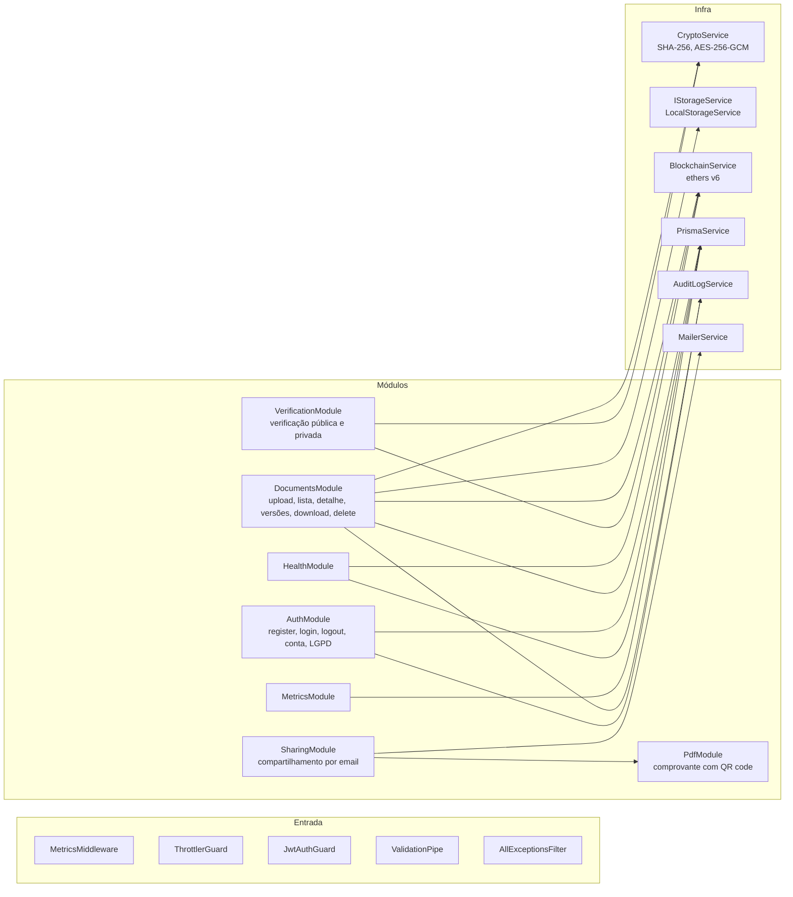
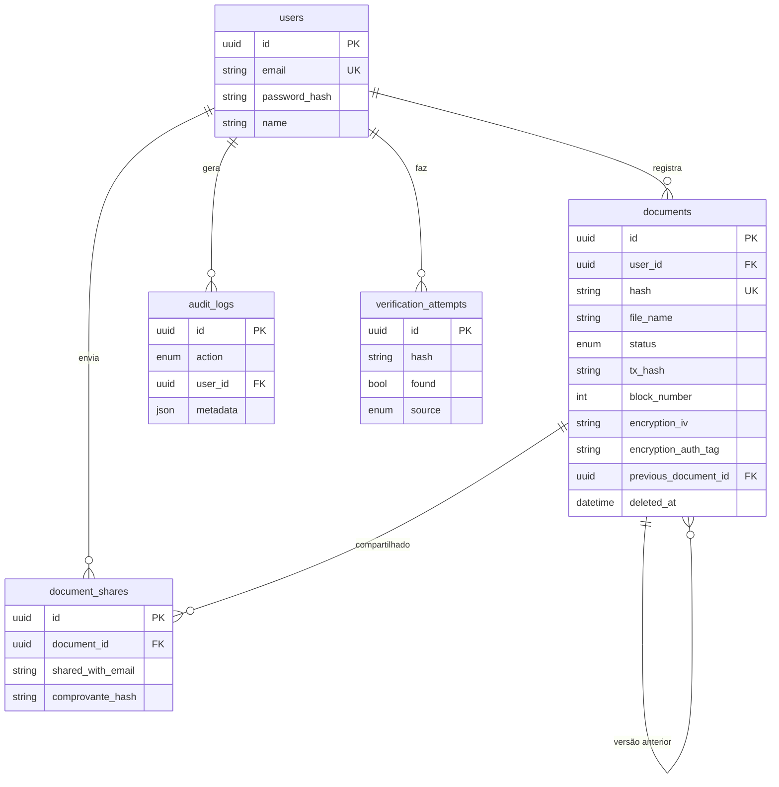

# Arquitetura

Modelo C4 em três níveis. As versões em imagem da RFC 1.2 estão em `RFC docs/artefatos_visuais/`; os diagramas abaixo refletem o estado atual do código, incluindo o monitoramento.

## Nível 1: Contexto

## Nível 2: Containers

## Nível 3: Componentes da API

## Decisões

| Decisão | Motivo |
| --- | --- |
| Hash do arquivo original on-chain, arquivo cifrado fora da chain | Prova de integridade sem expor conteúdo e sem custo de armazenar dados na blockchain |
| Carteira do backend assina as transações | Usuário não precisa de carteira nem de ETH (RNF16) |
| Hash único global | Semântica de cartório: um arquivo tem um único registro de existência |
| JWT em cookie `HttpOnly` + `SameSite=Lax` | Token inacessível a JavaScript (mitiga XSS); API stateless |
| Storage atrás de `IStorageService` | Trocar disco local por IPFS ou S3 sem mudar o domínio |
| Retry com backoff e lista de RPCs de fallback | Instabilidade de RPC público não derruba o registro |
| Versões encadeadas por `previousDocumentId` no banco | O contrato continua simples e imutável |
| Soft-delete local, registro on-chain preservado | Blockchain é imutável; a exclusão vale para o dashboard e o arquivo cifrado |

## Modelo de dados

