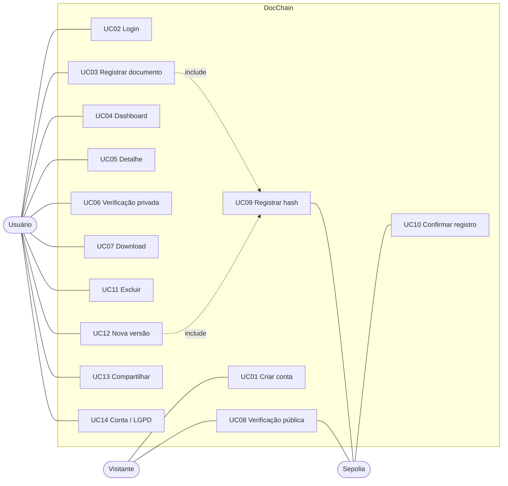
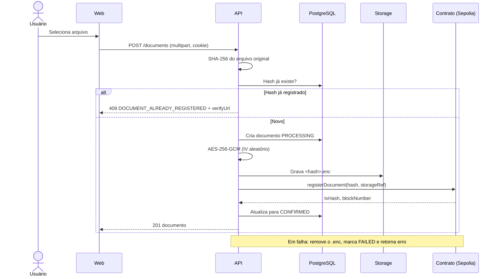
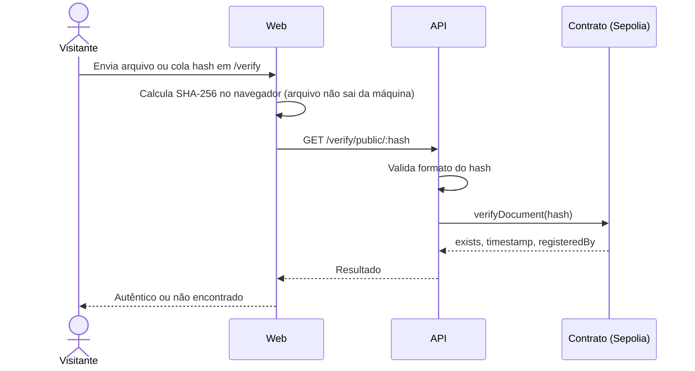

# Casos de Uso

## Atores

| Ator | Descrição |
| --- | --- |
| Visitante | Pessoa sem conta. Cria conta ou verifica documentos publicamente. |
| Usuário | Pessoa autenticada. Registra, consulta, baixa, versiona, compartilha e exclui documentos. |
| Blockchain (Sepolia) | Sistema externo onde o hash é registrado e consultado. |

## Casos de uso

| ID | Caso de uso | Ator | Descrição |
| --- | --- | --- | --- |
| UC01 | Criar conta | Visitante | Cadastro com email, senha e nome |
| UC02 | Fazer login | Usuário | Autenticação; recebe cookie `HttpOnly` com JWT |
| UC03 | Registrar documento | Usuário | Upload, hash, criptografia e registro on-chain |
| UC04 | Visualizar dashboard | Usuário | Lista paginada, filtros e estatísticas |
| UC05 | Ver detalhe do documento | Usuário | Metadados, hash, tx, link Etherscan, versões |
| UC06 | Verificar integridade (privada) | Usuário | Reenvia o arquivo e compara com o registro |
| UC07 | Baixar documento | Usuário | Recebe o arquivo original descriptografado |
| UC08 | Verificar publicamente | Visitante | Consulta por hash ou arquivo, sem login |
| UC09 | Registrar hash on-chain | Sistema | Envia `registerDocument` ao contrato |
| UC10 | Confirmar registro | Blockchain | Sistema aguarda o bloco e marca `CONFIRMED` |
| UC11 | Excluir documento | Usuário | Soft-delete; o registro on-chain permanece |
| UC12 | Criar nova versão | Usuário | Envia arquivo novo ligado ao documento anterior |
| UC13 | Compartilhar por email | Usuário | Envia link de verificação e comprovante ao destinatário |
| UC14 | Gerenciar conta (LGPD) | Usuário | Editar perfil, exportar dados, excluir conta |

## Fluxo principal: registro de documento (UC03)

## Fluxo alternativo: verificação pública (UC08)

## Exceções

| Código | Situação | Comportamento |
| --- | --- | --- |
| E01 | Hash já registrado | 409 com data do registro e link para verificação |
| E02 | Falha na blockchain | Retry com backoff e RPC de fallback; se persistir, `FAILED` e rollback do arquivo |
| E03 | Arquivo acima de 50 MB | 413, recusado antes do processamento |
| E04 | Hash com formato inválido | 400, sem chamada on-chain |
| E05 | Documento de outro usuário | 404 |
